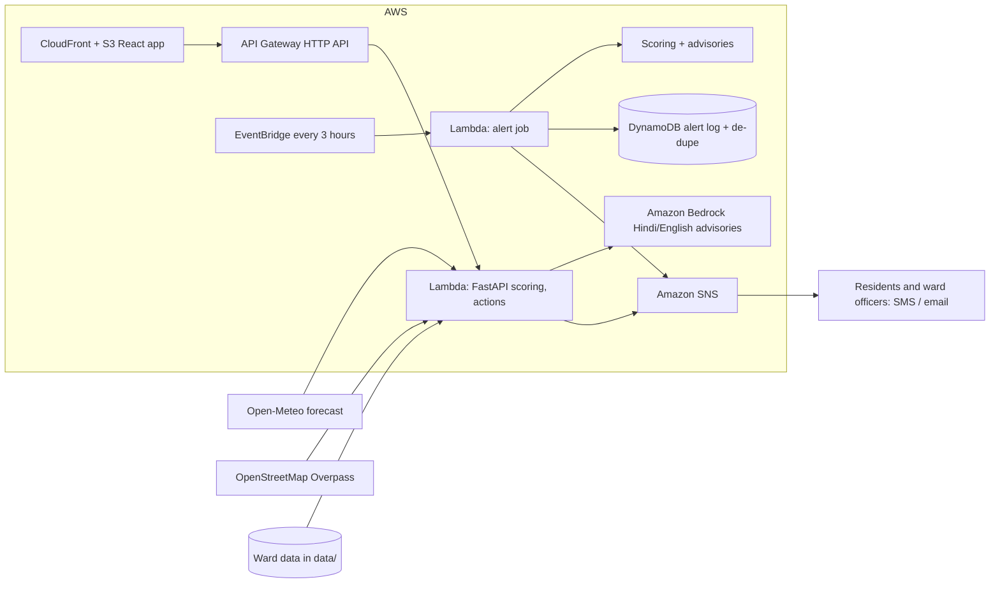

# HeatWatch architecture

## Why each service
| Service | Reason |
|---|---|
| Lambda + API Gateway | No servers to run, near-zero cost at demo scale, scales for a city. |
| Amazon Bedrock | Turns scores into short, plain-language Hindi and English advisories. A template is used if Bedrock is unavailable. |
| SNS | Delivers SMS or email alerts to residents and officers. |
| DynamoDB | Stops the same ward being alerted twice for the same day and risk level. |
| EventBridge | Refreshes forecasts and sends alerts every 3 hours without anyone clicking. |
| S3 + CloudFront | Hosts the React dashboard. |

## Scoring
- Heat risk = 35% feels-like temperature + 25% land-temperature anomaly + 15% low green cover + 15% density + 10% vulnerable share.
- Water stress = 60% distance to nearest water point + 40% scarcity of water points per 10,000 people.
- Priority = 65% heat + 35% water. Bands: Low below 25, Moderate to 50, High to 75, Extreme above 75.
